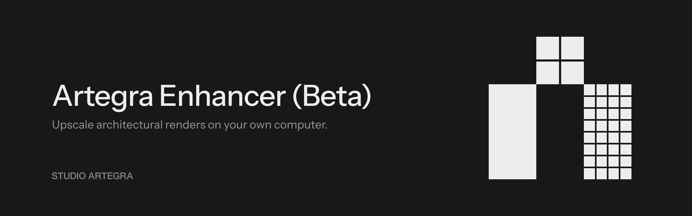

# Studio Artegra

## Artegra Enhancer (Beta)

Artegra Enhancer upscales architectural renders on your own Windows computer, with an NVIDIA RTX graphics card. It has two modes: Redux for finals and Bolt for quick drafts.

**[Download the installer for Windows](https://github.com/freddiefiasco/STUDIO-ARTEGRA/releases/download/artegra-enhancer-v5.0.0-beta.1/ArtegraEnhancer-5.0.0b1-Setup.exe)** (version 5.0.0 Beta 1)

Open the installer, accept the terms and choose Install. Setup downloads the image engine and about 14 GiB of models, so keep an internet connection for the first installation. Choose Finish to open Artegra Enhancer ready for your first image.

Artegra Enhancer (Beta) needs 64-bit Windows 10 22H2 or Windows 11 22H2 or newer, an NVIDIA RTX card with at least 8 GB of graphics memory, and 64 GB of system memory.

- [Features, requirements and screens](artegra-enhancer/)
- [Installation guide](artegra-enhancer/INSTALL.md)
- [Tips](artegra-enhancer/docs/TIPS.md), [questions and answers](artegra-enhancer/docs/FAQ.md) and [troubleshooting](artegra-enhancer/docs/TROUBLESHOOTING.md)
- [Release notes and checksums](https://github.com/freddiefiasco/STUDIO-ARTEGRA/releases/tag/artegra-enhancer-v5.0.0-beta.1)
- [Report a problem](https://github.com/freddiefiasco/STUDIO-ARTEGRA/issues/new/choose)
