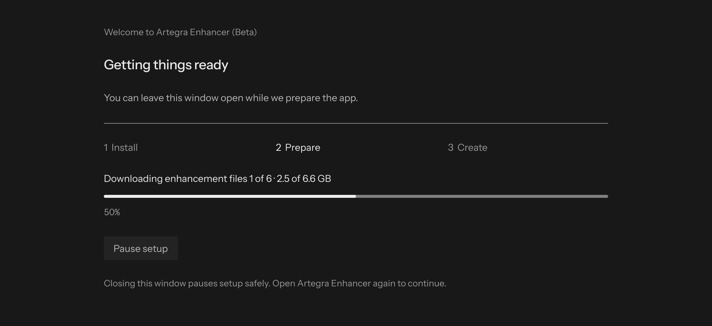

# Install Artegra Enhancer (Beta)

This guide covers downloading, installing, upgrading from an alpha, repairing and uninstalling. Setup installs everything Redux and Bolt need. You do not need Python, ComfyUI, a CUDA Toolkit or a terminal.

## Before you install

- Native 64-bit Windows 11 22H2 or newer, or Windows 10 22H2.
- An NVIDIA RTX graphics card with at least 8 GB of graphics memory, and a current NVIDIA Studio driver (595 or newer is recommended; 580 is the oldest that works).
- **64 GB of system memory.** On a computer with 32 GB, setup stops before the large downloads, even with a large pagefile.
- About **40 GB of free space** on an SSD for setup, plus room for your images. The models and the image engine take about 21 GiB.
- Internet access for the whole first installation. Download time depends on your connection.

Setup checks Windows, the graphics card, the driver, the memory and the free space before the large downloads. Testing covered Windows 11 and the RTX 5090; other cards and Windows 10 are expected to work but are not tested yet. See [the compatibility notes](docs/COMPATIBILITY.md).

## Download and check the file

| File | What it is |
| --- | --- |
| [ArtegraEnhancer-5.0.1b1-Setup.exe](https://github.com/freddiefiasco/STUDIO-ARTEGRA/releases/download/artegra-enhancer-v5.0.1-beta.1/ArtegraEnhancer-5.0.1b1-Setup.exe) | The installer. Use this one. |
| [ArtegraEnhancer-5.0.1b1-windows-x64.zip](https://github.com/freddiefiasco/STUDIO-ARTEGRA/releases/download/artegra-enhancer-v5.0.1-beta.1/ArtegraEnhancer-5.0.1b1-windows-x64.zip) | The portable copy, for experienced users. |
| [SHA256SUMS.txt](https://github.com/freddiefiasco/STUDIO-ARTEGRA/releases/download/artegra-enhancer-v5.0.1-beta.1/SHA256SUMS.txt) | The SHA-256 checksum of each file. |
| [SBOM.cdx.json](https://github.com/freddiefiasco/STUDIO-ARTEGRA/releases/download/artegra-enhancer-v5.0.1-beta.1/SBOM.cdx.json) | The list of components the app ships (CycloneDX). |

Download only from the [Studio Artegra release page](https://github.com/freddiefiasco/STUDIO-ARTEGRA/releases/tag/artegra-enhancer-v5.0.1-beta.1). To check a download, open PowerShell in your Downloads folder and run:

```powershell
Get-FileHash .\ArtegraEnhancer-5.0.1b1-Setup.exe -Algorithm SHA256
```

The hash it prints must match the line for that file in `SHA256SUMS.txt`. GitHub also shows each file's SHA-256 on the release page.

## Install, step by step

1. **Open the installer.** This Beta is not code-signed, so Windows SmartScreen may show "Windows protected your PC". Choose **More info**, check that the file is `ArtegraEnhancer-5.0.1b1-Setup.exe`, then choose **Run anyway**. Your browser may also say the file is not commonly downloaded; keep it. Setup installs for your Windows account and does not ask for administrator rights.
2. **Welcome.** Choose **Next**.
3. **Terms.** Read the software and model terms. They list each model, its publisher and its licence. Choose **I accept the software and model terms**, then **Next**. Nothing is downloaded before you accept.
4. **Installation location.** This is where Artegra Enhancer keeps its AI files: the models and the image engine. Keep the recommended location, or choose a folder on another drive with about 40 GB free. A local SSD is best. Your enhanced images are saved separately, in **Pictures → Artegra Enhancer**.
5. **Shortcuts.** Choose whether to add a desktop shortcut, then **Next**.
6. **Ready to install.** Choose **Install**.
7. **Preparing Artegra Enhancer.** Setup installs the app, then downloads and checks the image engine and six model files. This takes a while; you can keep using your computer. If the connection drops, downloads resume where they stopped.
8. **Finish.** When the last page says "Artegra Enhancer (Beta) is ready", leave **Open Artegra Enhancer** ticked and choose **Finish**. The app opens ready for your first image.

If the last page says "Setup needs to finish" or "Setup is paused", the app is installed but its AI files are not ready yet. Open Artegra Enhancer from the Start menu or the desktop to carry on. Checked downloads are kept.

## If setup stops or you close it

Keep the files already downloaded. Choose **Retry** in setup, run the installer again, or open Artegra Enhancer to continue. Checked files are reused and downloads resume. Setup never says the app is ready while files are missing.

When you open Artegra Enhancer before its files are ready, it shows its own setup page. Tick the box to accept the terms, then choose **Set up Artegra Enhancer**:


The page then shows what it is downloading and how far it has got. **Pause setup** stops safely, and so does closing the window; open the app again to resume.



If a driver, disk space or memory check fails, setup says what to do in the same window. It never changes your Windows drivers or your pagefile. Every message is listed in [Troubleshooting](docs/TROUBLESHOOTING.md#installing-and-setting-up).

## Upgrade from an alpha

Run the Beta's installer over your alpha; you do not need to uninstall first. It upgrades in place and keeps your images, output folder, settings, memory choice and enhancement files. Setup shows the terms page again and checks the enhancement files you already have instead of downloading them again. An alpha's Start menu and desktop shortcuts are replaced with the Beta's.

The upgrade was tested from alpha 4. Going back from the Beta to an alpha is not supported.

## Update from 5.0.0 Beta 1

Run the 5.0.1 installer over 5.0.0 Beta 1; you do not need to uninstall first. Your images, output folder, settings, waiting images and enhancement files are kept. Setup shows the terms page again and checks the enhancement files instead of downloading them again.

The memory limit 5.0.0 Beta 1 set by default becomes the new default: 59 GB on a 64 GB PC. If you changed `ram_cap_gb` in `settings.json` by hand to get round a memory refusal, 5.0.1 keeps your value. To use the new default:

1. Close Artegra Enhancer.
2. Open `%LOCALAPPDATA%\Studio Artegra\Artegra Enhancer\production\settings.json` in Notepad.
3. Delete the `"ram_cap_gb"` line and the comma at the end of the line above it, then save. If that comma stays, the app cannot read the file and goes back to its default settings, output folder included.
4. Open Artegra Enhancer again.

## Check for updates

**Settings → Check for updates** (also in **About**) asks GitHub whether a newer Artegra Enhancer release exists. If there is one, **Download** opens its release page in your browser; install it over your current copy. The app never checks on its own and never downloads or installs anything itself. [PRIVACY.md](PRIVACY.md) says exactly what the check sends.

## Repair

**Settings → Repair installation** checks the installed files and downloads anything missing, through the same steps as setup. Your images and your settings are kept. Running the installer again does the same check.

Do not copy DLLs or other software into the app's folders to fix an error. Use Repair.

## Portable ZIP

The ZIP is for experienced users who do not want an installer. Extract it to a short folder on a local drive, for example a folder named ArtegraEnhancer at the top of drive C, and open **ArtegraEnhancer.exe**. It shows the setup page above and makes the same downloads and checks.

Keep the folder path short. Under a folder path longer than about 110 characters, Windows cannot load some of the app's files and the window does not open. The portable copy has no uninstaller and no Start menu entry: to remove it, delete its folder.

## Offline use and network drives

After setup, Artegra Enhancer works without an internet connection. Setup and Repair need one, because the image engine and the models are downloaded from their publishers; there is no offline installer.

You can keep the AI files on a network drive, but it is slower. With the files on a network drive, installing over an existing installation took about two and a half minutes, and the uninstaller took about two minutes to show its options and about ten minutes to remove them. A local SSD is better.

## Where your files are

| What | Where |
| --- | --- |
| The app (about 400 MB) | `%LOCALAPPDATA%\Programs\ArtegraEnhancer` |
| AI files: models and image engine (about 21 GiB) | The location you chose in setup. By default `%LOCALAPPDATA%\Studio Artegra\Artegra Enhancer\data` |
| Settings and logs | `%LOCALAPPDATA%\Studio Artegra\Artegra Enhancer\production`. **Settings → Open logs** opens the log folder. |
| Enhanced images | **Pictures → Artegra Enhancer**, or the folder you choose in Settings |

Each enhanced image is saved with a .json file of the settings used, beside it.

## Uninstall

Use any of these:

- **Settings → Uninstall Artegra Enhancer…** in the app.
- **Start → Artegra Enhancer (Beta) → Uninstall Artegra Enhancer (Beta)**.
- **Windows Settings → Apps → Installed apps → Artegra Enhancer (Beta) → Uninstall**.

From the Start menu or Installed apps, Windows asks you to confirm. In the app, the app asks instead, and Windows does not ask again. The app's button is unavailable while images are being made: finish or cancel the batch first.


The uninstaller then shows two choices, both off by default:

- **Also remove downloaded enhancement files**, with their size beside it (the models are about 14 GiB; with the image engine the total is about 21 GiB). Only the files setup put in the app's own folder are removed. Anything else in that folder stays, including images saved there. A models folder you chose yourself is never touched.
- **Also remove settings and logs.** Only the app's own settings, logs and records are removed. Anything else in those folders stays.

The uninstaller first closes Artegra Enhancer and its image engine (only the app's own processes), then removes the app and its shortcuts. **Your enhanced images are never removed.** If you keep the enhancement files, a later install finds and checks them instead of downloading them again.

### For administrators

`unins000.exe /VERYSILENT` (or `/SILENT`) in the app folder removes the app and keeps everything optional. Add `/REMOVEFILES=1` and/or `/REMOVESETTINGS=1` to remove those too.

## Help

If something goes wrong, look up the message in [Troubleshooting](docs/TROUBLESHOOTING.md). To report a problem, use **Settings → Save support details**, check the file it saves, then attach it to a [new issue](https://github.com/freddiefiasco/STUDIO-ARTEGRA/issues/new/choose). Nothing is uploaded automatically.
