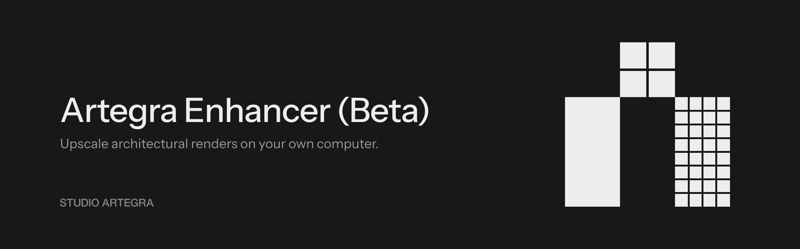
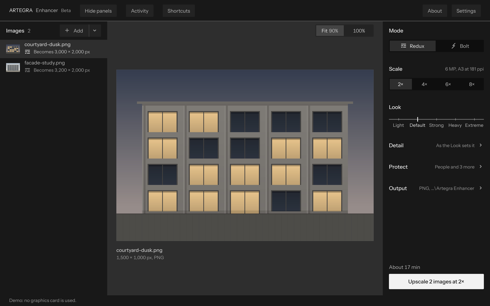
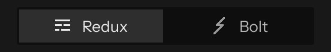
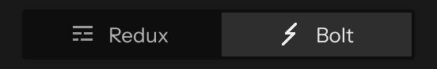
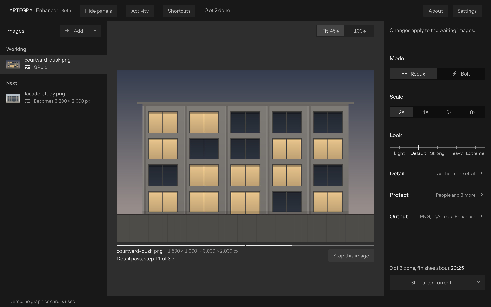
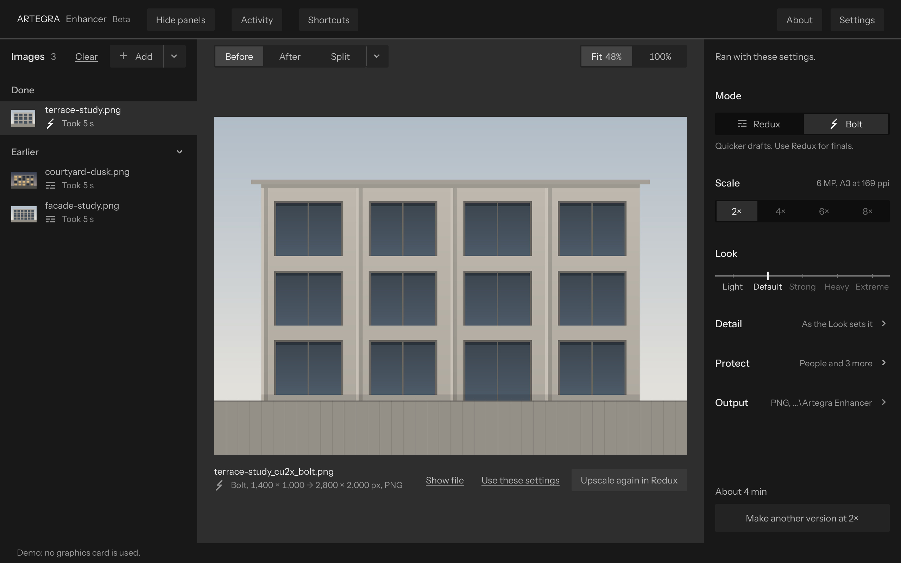
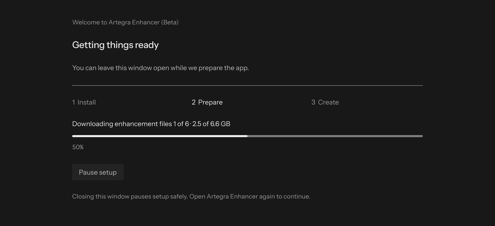

<p align="center">
  
</p>

# Artegra Enhancer (Beta)

Artegra Enhancer upscales architectural renders on your own Windows computer, using an NVIDIA RTX graphics card. Studio Artegra made it for visualisation artists who need larger, sharper images for print and presentation, without sending their work to an online service.

**[Download the installer for Windows](https://github.com/freddiefiasco/STUDIO-ARTEGRA/releases/download/artegra-enhancer-v5.0.0-beta.1/ArtegraEnhancer-5.0.0b1-Setup.exe)** (version 5.0.0 Beta 1)

Experienced users can take the [portable ZIP](https://github.com/freddiefiasco/STUDIO-ARTEGRA/releases/download/artegra-enhancer-v5.0.0-beta.1/ArtegraEnhancer-5.0.0b1-windows-x64.zip) instead. Checksums, the SBOM and the release notes are on the [release page](https://github.com/freddiefiasco/STUDIO-ARTEGRA/releases/tag/artegra-enhancer-v5.0.0-beta.1).



<sub>The screens on this page come from the app's demo engine with synthetic test pictures, so the times they show are not real.</sub>

## What you need

| | Needed |
| --- | --- |
| Windows | 64-bit Windows 11 22H2 or newer, or Windows 10 22H2. Tested on Windows 11. |
| Graphics card | An NVIDIA RTX card with at least 8 GB of graphics memory. Tested on the RTX 5090. |
| Graphics driver | An NVIDIA Studio driver: 595 or newer is recommended, 580 is the oldest that works. |
| System memory | 64 GB. On a computer with 32 GB, setup stops before the large downloads. A larger pagefile does not change this. |
| Disk space | About 40 GB free on an SSD for setup, plus room for your images. The enhancement files take about 14 GiB. |
| Internet | For the first installation and for Repair. Your images stay on your computer. |

Windows on ARM, 32-bit Windows and Windows 11 21H2 are not supported, and Windows Server is untested. There is no Mac or Linux version.

| Graphics card | Graphics memory | In this Beta |
| --- | --- | --- |
| RTX 5090 | 32 GB | Tested |
| RTX 4090, RTX 3090 | 24 GB | Expected to work, not tested yet |
| RTX 5080, RTX 4080 | 16 GB | Expected to work, not tested yet |
| RTX 3080 | 10 or 12 GB | Experimental, not tested yet |
| Laptop RTX cards | Varies | Not tested |

On cards with 24 GB or less, the app turns on **Save GPU memory** for you. The full list and its sources are in [the compatibility notes](docs/COMPATIBILITY.md).

## Redux and Bolt

| |  Redux |  Bolt |
| --- | --- | --- |
| Use it for | Finals | Drafts and quick checks |
| Scale | 2×, 4×, 6× and 8×. Above 2× it works in two or three passes. | 2× only |
| Look | Light, Default, Strong, Heavy and Extreme, or your own Detail settings | Light or Default |
| Image size | Up to 80 MP in and about 150 MP out | Up to about 9 MP |
| A 768 px crop at 2× on an RTX 5090 | About 3 minutes | About 1.5 minutes |
| Saved as | `name_cu2x.png` | `name_cu2x_bolt.png` |

Bolt is quicker and has a slightly different look. Use it to try a Look or check a composition, then make the final in Redux. A Bolt result offers **Upscale again in Redux** for exactly that.

<p>
  
  
</p>

Each mode's mark sits beside its name on the Mode control, on every image in the list and under every result, so you can see which mode made what.

With two identical RTX 5090 desktop cards, a single Bolt image is shared by both cards and finishes sooner. Everywhere else each Bolt image uses one card, and the finish time says so. Redux can share one image across two cards, as in the alphas; that was proven on two RTX 5090 cards only.

## A closer look



While a batch runs, the list shows which card has each image, the picture shows the step it is on, and the panel gives the finish time. **Stop after current** finishes the image in progress and moves the waiting ones to Stopped, where you can queue them again.



Each result can be compared with its original (**Before**, **After** and **Split**), opened in Explorer with **Show file**, or used as the starting point for the next run with **Use these settings**.


**Settings** holds the output folder, the graphics memory choice, **Check for updates**, **Repair installation**, **Save support details** and **Uninstall Artegra Enhancer…**.

## Quick start

1. Download **ArtegraEnhancer-5.0.0b1-Setup.exe** and open it. This Beta is not code-signed, so Windows may say it protected your PC. Choose **More info**, then **Run anyway**.
2. Read the software and model terms, accept them and choose **Install**. Keep the suggested location, or choose another drive for the enhancement files.
3. Leave setup open while it downloads and checks about 14 GiB of files. Choose **Finish** to open Artegra Enhancer.
4. Drag your renders into the window, or choose **Add**. Choose Redux or Bolt, a scale and a Look.
5. Choose **Upscale**. The results are saved in **Pictures → Artegra Enhancer**.

If setup is interrupted, or you use the portable ZIP, the app shows its own setup page, where you can pause and resume the downloads:



The [installation guide](INSTALL.md) covers each setup step, upgrading from an alpha, repair and uninstalling.

## Tips

- **Draft in Bolt, finish in Redux.** Bolt shows in about half the time whether a Look suits a render. When it does, choose **Upscale again in Redux** for the final.
- **Start with Default.** Light adds fine detail and keeps each plant's species. Strong, Heavy and Extreme add more new detail and may redraw planting, so check trees and fine shapes at 100 %.
- **Go up in steps.** 4× and above take longer and add more invented detail. Try 2× first and look at it at 100 % (press 1) before you queue a larger scale.
- **Protect what must not change.** By default, Protect keeps people, furniture, vehicles, windows and glass as they are. You can add architecture.
- **Leave graphics memory on Auto.** On cards with 24 GB or less it saves memory. If an image runs out of memory, the app offers to try again with **Save GPU memory**.
- **Choose the drive at install time.** The enhancement files take about 14 GiB. Put them on a local SSD with room to spare; a network drive works but is slower.

More in [Tips](docs/TIPS.md), including the keyboard shortcuts.

## Guides

- [Installation guide](INSTALL.md): download, setup, upgrade, repair, uninstall and checksums
- [Tips](docs/TIPS.md): choosing a mode, Looks and scales, memory, two cards and where files go
- [Questions and answers](docs/FAQ.md)
- [Troubleshooting](docs/TROUBLESHOOTING.md): every message the app can show, with what to do
- [Known issues](KNOWN-ISSUES.md)
- [Compatibility](docs/COMPATIBILITY.md): Windows, drivers, graphics cards and memory
- [Privacy](PRIVACY.md)
- [Model sources and licences](MODEL-LICENSES.md)
- [Security](SECURITY.md)
- [Validation record](docs/VALIDATION.md): what was tested for this Beta, and how
- [Changelog](CHANGELOG.md)
- [Building from source](docs/BUILDING.md)

## Privacy

Your images are processed on your computer and are never uploaded. The app has no analytics. It goes online only when you install or repair it, to download the image engine and the models from their publishers, and when you choose **Check for updates**, which asks GitHub for the list of releases. Each enhanced image is saved with a .json file of its settings, which includes the full paths of the original and the result; remove those files before you send a folder to anyone. The details are in [PRIVACY.md](PRIVACY.md).

## Licences and model terms

The app's own code (the host, the service and the interface) is source-available under [LICENSE.txt](LICENSE.txt). The node pack and the runtime patches are GPL-3.0. Other components keep their own licences; see [THIRD-PARTY-NOTICES.txt](THIRD-PARTY-NOTICES.txt).

The models are not part of the download. Setup fetches each one from its publisher after you accept its terms. Those terms differ from model to model, and some limit how outputs may be used, so read [MODEL-LICENSES.md](MODEL-LICENSES.md) before using results commercially. This Beta is provided for evaluation under the [beta terms](BETA-TERMS.md).

## Support and feedback

To report a problem, open **Settings → Save support details**, check the file it saves, then [open an issue](https://github.com/freddiefiasco/STUDIO-ARTEGRA/issues/new/choose) and attach it. The support file leaves out your images and replaces paths, file names and addresses with `<redacted>`. [FEEDBACK.md](FEEDBACK.md) lists what a useful report includes. For a security problem, follow [SECURITY.md](SECURITY.md) instead of opening a public issue.

## What's new in 5.0.0 Beta 1

- Standard is now **Redux** and Fast is now **Bolt**, each with its own mark.
- A single Bolt image can share two identical RTX 5090 cards.
- The image workspace has all the fixes made since alpha 4.
- **Check for updates** in Settings and About.
- A Windows uninstaller in Settings, the Start menu and Installed apps.

Saved images are made by the same engine and recipes as in the alphas; only the live preview's fallback changed. On an RTX 5090 the Beta's Redux and Bolt renders matched the reference renders pixel for pixel. The full list is in the [changelog](CHANGELOG.md) and the evidence in the [validation record](docs/VALIDATION.md).

Not in this Beta: **Faster** ("Speed up upscaling") stays off, and graphics cards other than the RTX 5090 are untested.

## From source

```powershell
uv sync --locked
uv run python -m host.app --demo
```

Demo mode uses a simulated engine and no graphics card. Leave out `--demo` for real processing after setup. Release maintainers should follow [the Windows build and verification instructions](docs/BUILDING.md). The images in this README are made by [`docs/assets/make_assets.py`](docs/assets/make_assets.py).

The API calls Redux `standard` and Bolt `fast`; stored jobs and settings keep those names.
